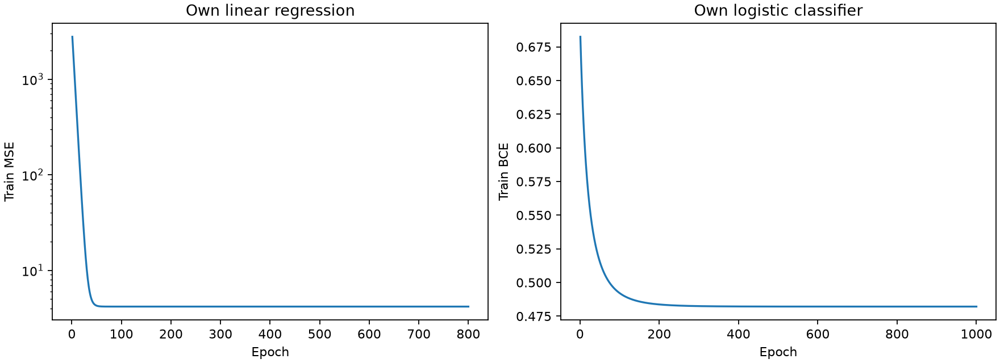
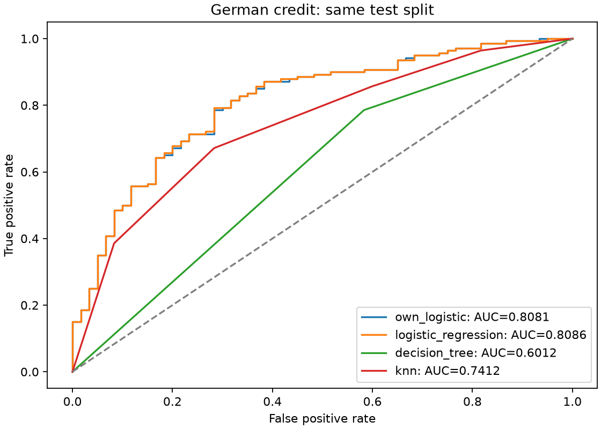

# Лабораторная №3. Линейные модели

## 1. Данные и подготовка

Student_Performance.csv: 10000 наблюдений, 5 признаков; цель Performance Index. Extracurricular Activities: Yes → 1, No → 0. Разбиение 80/20, train=8000, test=2000, random_state=42.

german.csv читается с разделителем `;`: 1000 наблюдений, 20 признаков; первый столбец Creditability — цель. Стратифицированное разбиение 80/20: train=800, test=200. В test: класс 0 — 60, класс 1 — 140. Положительный класс для Precision/Recall/F1 — 1 (Creditability=1); это не метрики поиска класса 0.

Пропусков в обоих файлах нет (проверено кодом). Числовые коды категорий German используются как предоставлены: это простой базовый эксперимент; расстояния между номинальными кодами не имеют гарантированного содержательного смысла, особенно для KNN. One-hot кодирование — направление дальнейшего улучшения, в эти результаты не включено.

Для каждого датасета отдельный StandardScaler обучается **только на train**; test преобразуется теми же средними и масштабами. Цель регрессии не масштабируется. Веса функций относятся к переданным, в эксперименте стандартизованным, признакам. Все классификаторы используют одинаковые train/test и одинаковые признаки; тестовые цели не участвуют в обучении.

## 2. Гипотезы и эксперименты

Своя регрессия: нулевые веса и смещение, полный пакет, MSE; градиенты `2 X.T @ error / n` и `2 mean(error)`. Основной запуск: learning_rate=0.05, epochs=800. Свой классификатор: линейный logit, устойчивая sigmoid, BCE через logaddexp; градиенты `X.T @ (p-y) / n` и `mean(p-y)`. Основной запуск: learning_rate=0.1, epochs=1000, порог 0.5. История содержит loss после каждого обновления, её длина равна epochs. Регуляризации и ранней остановки в собственных моделях нет.

Гипотезы: при масштабировании MSE устойчиво снижается; меньший шаг требует большего числа эпох; дерево и KNN могут учитывать нелинейные зависимости, но чувствительны к переобучению и кодированию признаков. Ниже реальные запуски с заранее фиксированными параметрами. Основные настройки взяты из контрактов и не выбирались по лучшей test-метрике. Для настоящего подбора потребуется отдельная validation/CV.

| Модель | Шаг | Эпохи | Первый train loss | Последний train loss | Test MSE / ROC-AUC |
|---|---:|---:|---:|---:|---:|
| linear | 0.01 | 800 | 3292.539047 | 4.169736 | 4.082628 |
| linear | 0.05 | 800 | 2777.910810 | 4.169736 | 4.082628 |
| linear | 0.1 | 800 | 2196.175555 | 4.169736 | 4.082628 |
| own_logistic | 0.03 | 300 | 0.689902 | 0.494752 | 0.824762 |
| own_logistic | 0.03 | 1000 | 0.689902 | 0.482489 | 0.813214 |
| own_logistic | 0.1 | 300 | 0.682462 | 0.482483 | 0.813214 |
| own_logistic | 0.1 | 1000 | 0.682462 | 0.482132 | 0.808095 |

Готовые модели: sklearn LogisticRegression, C=1, penalty по умолчанию (L2), max_iter=2000; DecisionTreeClassifier без ограничения глубины, random_state=42; KNeighborsClassifier, k=5, евклидово расстояние и равные веса. Для обучающей выборки менее пяти строк k ограничивается её размером.

## 3. Метрики

Линейная регрессия: test MSE = **4.082628**. Train MSE после первой эпохи = 2777.910810, после последней = 4.169736.

Свой классификатор: train BCE 0.682462 → 0.482132. ROC-AUC считается по вероятностям, остальные метрики — по меткам. Деление на ноль в Precision/Recall/F1 обрабатывается `zero_division=0`; ROC-AUC требует оба класса на test.

| Модель | ROC-AUC | Accuracy | Precision | Recall | F1 |
|---|---:|---:|---:|---:|---:|
| own_logistic | 0.808095 | 0.770000 | 0.801282 | 0.892857 | 0.844595 |
| logistic_regression | 0.808571 | 0.770000 | 0.801282 | 0.892857 | 0.844595 |
| decision_tree | 0.601190 | 0.675000 | 0.758621 | 0.785714 | 0.771930 |
| knn | 0.741190 | 0.720000 | 0.769231 | 0.857143 | 0.810811 |





## 4. Выводы

Все три шага линейной регрессии к 800-й эпохе дали практически одинаковую test MSE; большой шаг быстрее снижает начальную ошибку. Для логистической модели снижение train BCE не гарантирует улучшения test ROC-AUC: при шаге 0.03 и 300 эпохах AUC = 0.824762, а в основном запуске = 0.808095. Это аргумент в пользу проверки ранней остановки на отдельной validation-выборке, а не выбора лучшего запуска по test.

Собственные модели обучены пакетным градиентным спуском без готовых линейных моделей sklearn внутри двух train-функций. Снижение тренировочной ошибки видно по таблице и графикам. Сравнение собственной логистической модели с остальными (собственная минус baseline):

- Против logistic_regression: разница ROC-AUC -0.000476; Accuracy +0.000000.
- Против decision_tree: разница ROC-AUC +0.206905; Accuracy +0.095000.
- Против knn: разница ROC-AUC +0.066905; Accuracy +0.050000.

Различие со sklearn ожидаемо: у эталона L2-регуляризация и другой оптимизатор, у нашей модели фиксированное число шагов без регуляризации. Дерево без ограничения глубины может переобучаться; KNN зависит от масштаба и смысла расстояний. Это объяснения возможных причин, а не доказательство причинности по одному разбиению. Результаты относятся к seed=42 и не доказывают превосходство на других выборках; для устойчивого вывода нужна кросс-валидация.

В README упомянуты собственная логистическая модель, дерево и KNN, а docstring compare_classical_models и схема JSON требуют также готовую LogisticRegression. Поэтому сравниваются все четыре: функция compare_classical_models заполняет три поля контракта готовыми baseline-моделями, собственная модель рассчитана отдельно на **том же** split и включена в REPORT и JSON как own_logistic.

## 5. Воспроизводимость

Запуск из папки проекта (Python 3.12+ для зафиксированных версий библиотек):

```bash
python -m pip install -r requirements.txt
python run_experiments.py
python -m unittest discover -v
```

Для просмотра графиков: `python run_experiments.py --show`. В обычной графической среде визуальный тест также показывает графики; закройте окна, чтобы завершить тесты. Для автоматического запуска без окон: `MPLBACKEND=Agg python -m unittest discover -v`.

Эксперимент пишет experiment_results.json, experiment_details.json, REPORT.md и два PNG в папку проекта. Параметры random_state=42; scaling обучается на train, классификационное разбиение стратифицировано. Фактическая среда: Python 3.12.14, NumPy 2.5.4, Pandas 3.1.1, scikit-learn 1.9.1, Matplotlib 3.11.2.

JSON содержит числа полной точности. В предоставленном стартовом файле обещанная численная погрешность не указана; для собственной проверки выбран допуск 1e-6. Округление в отчёте — до шести знаков. Скрытые тесты преподавателя недоступны.
